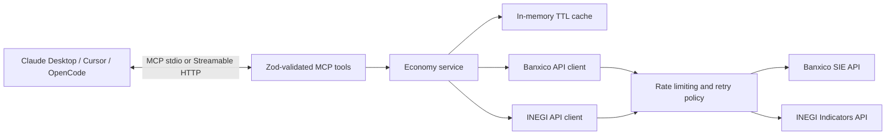

# mcp-mx-economy

An open-source Model Context Protocol (MCP) server that gives AI assistants access to Mexican economic indicators from Banco de México (Banxico) and INEGI. It turns official time-series APIs into typed, discoverable tools that an agent can use to answer questions with source dates and values.

Repository: [github.com/JEHH97/mcp-mx-economy](https://github.com/JEHH97/mcp-mx-economy)

> **Demo:** [Live demo placeholder — add a hosted demo URL when one is available]

## The problem

Economic context is often spread across separate government data portals. An assistant should be able to retrieve a current exchange rate, compare indicators, and explain the observation period without a person manually navigating multiple APIs. This server provides a small, auditable bridge to those public data sources and never invents missing observations.

## Architecture



## Stack

- TypeScript, Node.js 20+, and the official `@modelcontextprotocol/sdk`
- Zod input and output contracts
- Banxico SIE REST API and the INEGI Indicators API
- Vitest, ESLint, Prettier, TypeScript, and tsup
- GitHub Actions for repeatable quality checks

## Tools

| Tool                    | Purpose                                                             |
| ----------------------- | ------------------------------------------------------------------- |
| `mx_fix_rate`           | Latest FIX exchange rate or a historical date range                 |
| `mx_target_rate`        | Latest Banxico target interest rate                                 |
| `mx_inflation`          | Latest INPC index plus computed monthly and year-over-year change   |
| `mx_udis`               | Latest UDIS value                                                   |
| `mx_tiie_28d`           | Latest 28-day TIIE reference rate                                   |
| `mx_banxico_series`     | Latest value or date range for a Banxico series identifier          |
| `mx_inegi_indicator`    | Latest or historical observations for an INEGI indicator identifier |
| `mx_compare_indicators` | Latest observations for multiple Banxico and/or INEGI identifiers   |

Built-in Banxico references are FIX (`SF43718`), target rate (`SF61745`), INPC (`SP1`), UDIS (`SP68257`), and TIIE 28-day (`SF60648`). The SIE API returns observations with `N/E` as unavailable; those are represented as `null` rather than a fabricated number. INEGI results retain the provider's observation period.

## Technical decisions

- **Provider-specific clients behind a service layer:** tool registration stays focused on MCP contracts; API details and calculations remain independently testable.
- **Small, in-memory cache:** successful provider responses are cached for one minute to reduce redundant upstream requests. This is intentionally process-local and does not persist data.
- **Conservative outbound pacing and bounded retries:** requests are serialized with a minimum interval, and transient network, throttling, and server failures use exponential backoff. Invalid requests and provider client errors are not retried.
- **Helpful, typed failures:** missing tokens identify the exact environment variable; other tool failures return concise messages suitable for an assistant to relay.
- **No runtime framework for HTTP:** the optional Streamable HTTP transport uses Node's built-in HTTP server, while stdio remains the default for desktop clients.
- **Fixture-driven tests:** automated tests inject HTTP responses and use MCP's in-memory client/server transport; they do not call public services or use real credentials.

## Local setup

Requirements: Node.js 20 or newer and npm.

```sh
git clone https://github.com/JEHH97/mcp-mx-economy.git
cd mcp-mx-economy
npm install
cp .env.example .env
# Edit .env and add your personal provider tokens.
npm run build
npm start
```

The server reads `BANXICO_TOKEN` and `INEGI_TOKEN` from the process environment. A token is only required by tools that query its corresponding provider. Without one, that tool returns a clear token-setup message. The example environment file contains placeholders only.

To run the optional Streamable HTTP transport:

```sh
MCP_TRANSPORT=http MCP_HTTP_PORT=3333 npm start
```

The endpoint is available at `http://127.0.0.1:3333/mcp`. Keep it local unless you add suitable authentication and network controls.

### Claude Desktop

Add the following to the MCP server section of the Claude Desktop configuration, replacing the project path with its absolute path and providing tokens in the environment object:

```json
{
  "mcpServers": {
    "mx-economy": {
      "command": "node",
      "args": ["/absolute/path/to/mcp-mx-economy/dist/index.js"],
      "env": {
        "BANXICO_TOKEN": "your-personal-token",
        "INEGI_TOKEN": "your-personal-token"
      }
    }
  }
}
```

### Cursor

Add a project MCP entry in `.cursor/mcp.json`:

```json
{
  "mcpServers": {
    "mx-economy": {
      "command": "node",
      "args": ["/absolute/path/to/mcp-mx-economy/dist/index.js"],
      "env": {
        "BANXICO_TOKEN": "your-personal-token",
        "INEGI_TOKEN": "your-personal-token"
      }
    }
  }
}
```

### OpenCode

Register a local command in the OpenCode MCP configuration. The following illustrates the command and environment shape; adapt it to the configuration format in your installed OpenCode version:

```json
{
  "mcp": {
    "mx-economy": {
      "type": "local",
      "command": ["node", "/absolute/path/to/mcp-mx-economy/dist/index.js"],
      "environment": {
        "BANXICO_TOKEN": "your-personal-token",
        "INEGI_TOKEN": "your-personal-token"
      },
      "enabled": true
    }
  }
}
```

## Get free API tokens

- **Banxico:** request a SIE API token at [Banxico SIE API token page](https://www.banxico.org.mx/SieAPIRest/service/v1/token). Requests use the `Bmx-Token` HTTP header.
- **INEGI:** register for an API token from the [INEGI Indicators API page](https://www.inegi.org.mx/servicios/api-indicadores/). The token is part of the documented indicator endpoint path.

Provider references: [Banxico SIE API documentation](https://www.banxico.org.mx/SieAPIRest/service/v1/?locale=en) and [INEGI Indicators API documentation](https://www.inegi.org.mx/servicios/api-indicadores/).

## Example questions

- “What is the latest Banxico FIX exchange rate, and what date does it refer to?”
- “Show me the FIX exchange rate from the first day of last month through today.”
- “What is the latest monthly INPC reading, and how did it change versus the previous month and the same month last year?”
- “Compare the latest target rate, TIIE 28-day, and UDIS observations.”
- “Fetch the latest national reading for my INEGI unemployment indicator ID.”
- “Compare these Banxico series IDs and tell me their observation periods.”

## Tests and quality

All checks run through one command:

```sh
npm run check
```

It runs ESLint, Prettier validation, TypeScript typechecking, Vitest with domain-logic coverage thresholds, a production build, and the forbidden-content scan. Tests use recorded fixture payloads, injected mock HTTP, and an in-memory MCP protocol client; they do not need tokens or network access.

## License

MIT. See [LICENSE](LICENSE).
